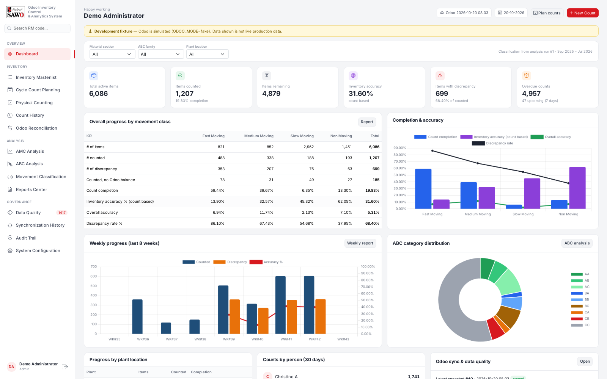
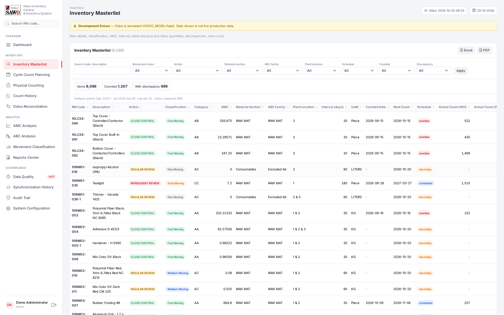
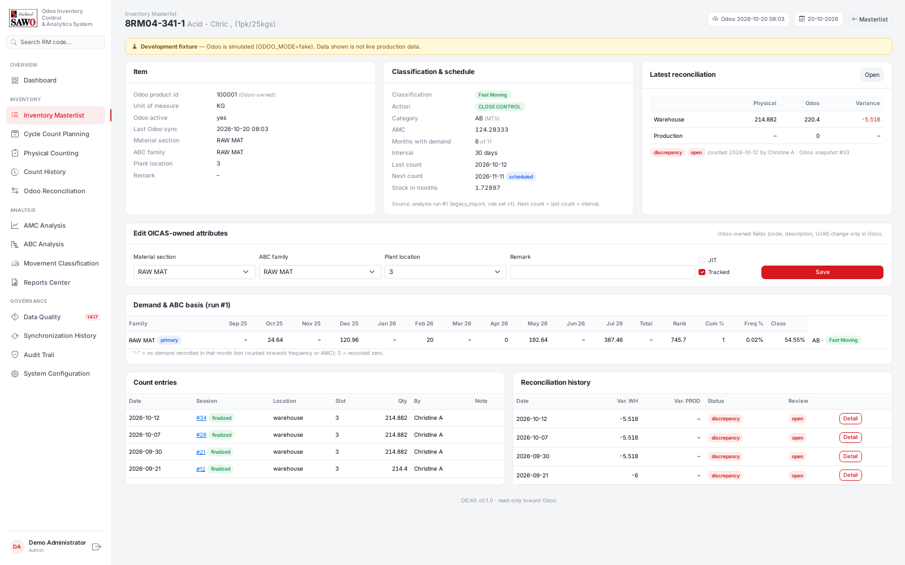
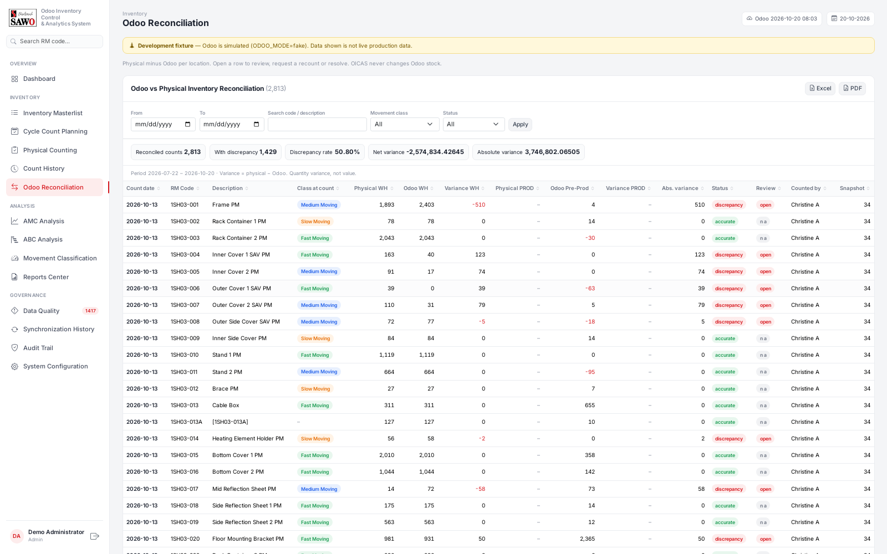

<p align="center"></p>

# OICAS — Odoo Inventory Control & Analytics System

OICAS replaces SAWO's manual Excel workflow (*AMC/ABC analysis → Inventory Masterlist → COUNTED LIST → progress dashboards*) with one connected web application. It:

- reads products, locations, on-hand stock and manufacturing demand from **Odoo (read-only)** and keeps immutable snapshots;
- calculates **AMC, ABC (quantity × frequency), movement class and count interval** with the same formulas as the workbooks (verified by parity tests);
- **plans** cycle counts (due, overdue, never counted, by priority, plant and person);
- records **physical counts** per location with full history (no silent overwrites; corrections and recounts are audited);
- **reconciles** against Odoo (*physical − Odoo* per warehouse / pre-production) and runs a discrepancy review workflow;
- shows the **dashboard** and **16 reports** with Excel/PDF export.

Users log in with their **Odoo account**. The UI follows the SAWO *General Automation System* design.

> Live progress: [TRACKER.md](TRACKER.md) · Requirements: [docs/Task.md](docs/Task.md)

---

## Quick start (local, simulated Odoo)

Requires Docker Desktop.

```bash
cp .env.example .env                       # ODOO_MODE=fake by default; set POSTGRES_PASSWORD
docker compose up -d --build               # http://localhost:8086
docker compose exec web python -m oicas.cli import-legacy   # migrate the Excel history (one-off)
docker compose exec web python -m oicas.cli sync            # first (simulated) Odoo sync
```

Log in as `admin` / `manager` / `counter` / `viewer` with password `demo` (fake mode only). Then go to **System Configuration → Odoo locations**, map `WH/Stock` → WAREHOUSE and `WH/Pre-Production` → PRODUCTION, and run *Sync Odoo now*.

Connecting to the real Odoo: see [docs/odoo-integration.md](docs/odoo-integration.md). Production deployment, backups and operations: see [docs/admin-guide.md](docs/admin-guide.md).

## Run the tests

```bash
docker build --build-arg INSTALL_DEV=true -t oicas-dev backend
docker run --rm -v "$PWD:/repo" -w /repo/backend oicas-dev python -m pytest -q
```

65 tests: formula parity against the workbooks, end-to-end migration parity, services and web (roles, CSRF, workflows, exports). Results: [docs/parity-results.md](docs/parity-results.md).

## Repository guide

| Path | Contents |
|---|---|
| [backend/oicas/engine/](backend/oicas/engine/) | **Pure calculation engine**: AMC, ABC, classification, reconciliation, progress metrics, scheduling. Every official number comes from here |
| [backend/oicas/services/](backend/oicas/services/) | Database and workflow layer: sync, analysis runs, counting, masterlist dataset, reports, exports, importers, data quality, audit |
| [backend/oicas/odoo/](backend/oicas/odoo/) | Read-only Odoo gateway (`LiveOdoo`) and test/demo fixture (`FakeOdoo`) |
| [backend/oicas/web/](backend/oicas/web/) | FastAPI routes, Jinja2 templates, static assets (vendored Bootstrap/Icons/htmx/Chart.js, SAWO logo) |
| [backend/alembic/](backend/alembic/) | Database migrations |
| [backend/tests/](backend/tests/) | Parity, service and web tests |
| [docs/analysis/](docs/analysis/) | Phase-1 reverse engineering of the four workbooks (inventory, data dictionary, **formula register**, dependency map, process map, mapping, report catalog, business rules, data-quality register, **unresolved decisions**) |
| [docs/reference/](docs/reference/) | The four legacy workbooks (business data: keep this repository **private**) |
| [docs/architecture.md](docs/architecture.md) · [user-guide.md](docs/user-guide.md) · [admin-guide.md](docs/admin-guide.md) · [odoo-integration.md](docs/odoo-integration.md) · [parity-results.md](docs/parity-results.md) | Documentation |
| [tools/](tools/) | Workbook analysis scripts used in Phase 1 |
| [compose.yaml](compose.yaml), [.env.example](.env.example) | Deployment |

## How the Excel workflow maps to OICAS

| Excel today | OICAS |
|---|---|
| Export MO demand, refresh pivot, paste into `Demand` | *AMC Analysis → Sync demand* (or upload the export) |
| Family sheets + CLASS + CONSOLIDATED | *Analysis run* (draft → review changes → approve), versioned rule set |
| Copy CONSOLIDATED into the Masterlist | Automatic: the Masterlist always uses the approved run |
| Download Odoo stock, paste into `ODOO inv` / LIST | Scheduled Odoo sync → immutable snapshot |
| Type e-mailed counts into `LIST` | Count sessions (direct entry or count-sheet upload) |
| External-link formulas in Master (K…U) | Reconciliation engine at finalisation |
| PROGRESS-overall / PROGRESS-weekly (typed weekly values) | Dashboard + reports 6 and 7, calculated from count records |
| Filter NEXT COUNT, export to plan | *Cycle Count Planning* + printable / Excel count sheets |

## Working agreement

1. Record every change in the **Change Log** of [TRACKER.md](TRACKER.md) and keep the phase checklist current.
2. Official calculations live only in `engine/`. When a rule changes, update the formula register, the business-rules register and the parity tests in the same commit.
3. Open business questions go in [docs/analysis/10-unresolved-decisions.md](docs/analysis/10-unresolved-decisions.md). Configurable rules change through a **new rule-set version**, never through code edits.
4. Never commit `.env`, secrets, database dumps or production exports. OICAS must stay **read-only toward Odoo**.

## Screenshots

| Dashboard | Inventory Masterlist |
|---|---|
|  |  |
| **Item detail** | **Odoo reconciliation** |
|  |  |
