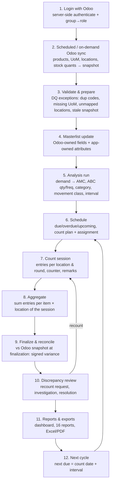

# 05 — Current-State Business Process Map and Target Workflow

## Current state (manual)

| # | Step | Actor | Tool | Manual operation | Pain / risk |
|---|---|---|---|---|---|
| 1 | Export MO component demand from Odoo (Created on, Reference, Name, Demand) | Inventory analyst | Odoo list export → W1 Sheet1 | Export, paste | 83k rows; period chosen by hand |
| 2 | Refresh pivot by month; paste values to `Demand` | Analyst | Excel pivot | Copy / paste values | Stale pivot, label drift ("TOTAL Sep-May") |
| 3 | Maintain 11 family sheets (code lists per material section); fill Material Section and Plant Location | Analyst | Excel | Typing, **manual sort by TOTAL desc** | RM sheet unsorted, truncated total (DQ-01/02) |
| 4 | CONSOLIDATED stacks families; interval looked up | – | Excel 365 dynamic arrays | – | 182 duplicate codes across families |
| 5 | Copy CONSOLIDATED B:C and Z:AF into Masterlist A:I | Analyst (Jovielyn) | Excel | **Copy/paste between workbooks** | Classification drift (4 diffs; 94 items missing) |
| 6 | Export Odoo product list → DATA sheets (UoM, description) | Analyst | Odoo export | Paste | 41 UoM not found |
| 7 | Inventory in-charge counts stock and e-mails an Excel count form | Counter (Christine A, Giniemark) | Excel / e-mail / chat | – | No audit trail; corrections via chat ("09.03 for re-check…") |
| 8 | Type count lines into COUNTED LIST `LIST` (date, code, WH-1..4, PROD-1..4, counted by, remarks) | Analyst | Excel | **Re-typing** | Duplicate lines (14), unknown codes (102) |
| 9 | Download Odoo on-hand per location on count day → `ODOO inv`; paste WH / Pre-prod into LIST P,Q | Analyst | Odoo export | **Copy / paste** | Snapshots overwritten; only 923/1,370 balances still traceable |
| 10 | Masterlist pulls latest count, Odoo balance, discrepancy via external link | – | Excel external link to `\\172.16.0.4\...` | Refresh links | Broken links if the file moves |
| 11 | PROGRESS-overall recalculates; PROGRESS-weekly totals **typed** per class per week | Analyst | Excel | Counting / filtering, typing | #DIV/0! on empty weeks |
| 12 | Filter Masterlist by NEXT COUNT, download as Excel to plan the next count | Analyst | Excel | Filter / export | Never-counted items have no due date |

## Target workflow (OICAS)

Manual operations that are removed: steps 2, 5, 6, 8 (typing is replaced by direct entry or count-sheet upload), 9, 10 and 11.
Manual operations that remain, by design: physical counting, maintaining Material Section / Plant Location (app-owned attributes), approving analysis runs, and resolving discrepancies.
